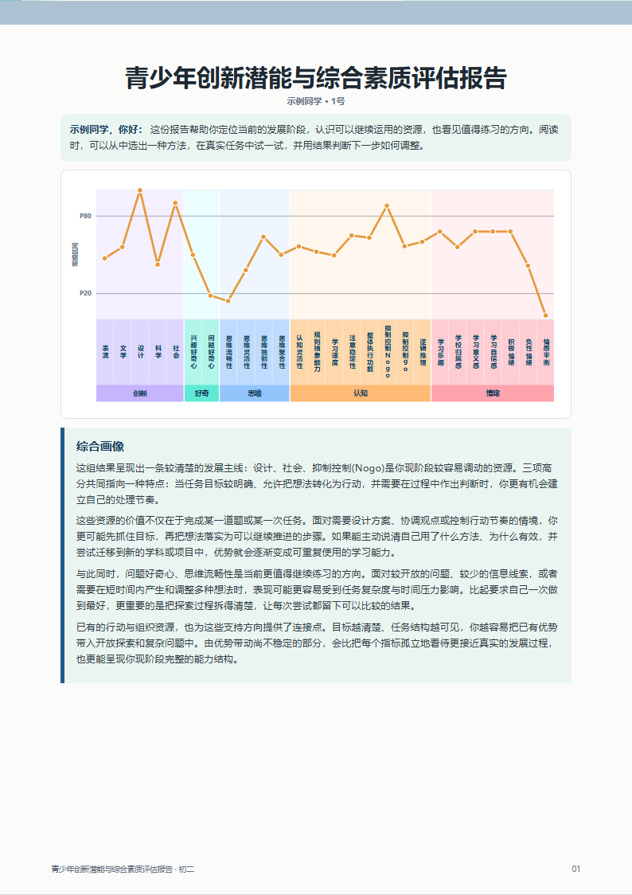
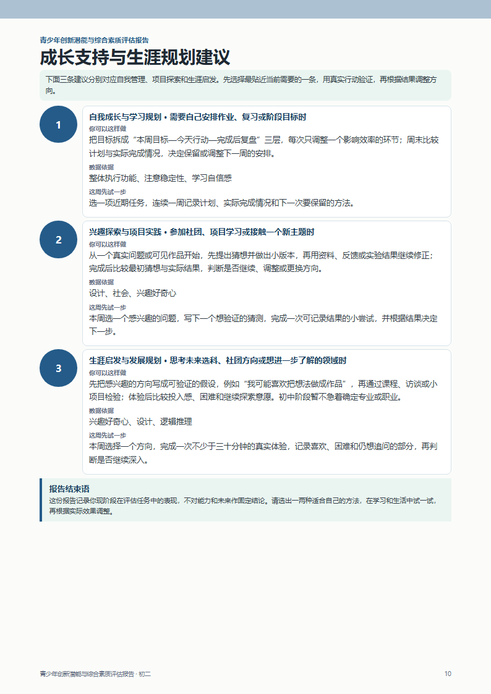
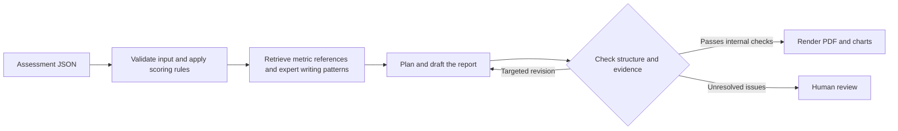

# PsychReportAgent

**A modular multi-agent system for student assessment reporting**

PsychReportAgent turns structured psychological and cognitive assessment scores into illustrated Chinese-language PDF reports. The prototype helps families and students understand what an assessment measured and identify practical next steps.

[Report preview](#report-preview) · [System architecture](#system-architecture) · [Project contributions](#project-contributions)

## Report preview

The pages below were rendered by the prototype with invented scores and scripted demonstration text.

  
  

[Open the assessment overview](preview/assessment-overview.png) · [Open the growth suggestions](preview/growth-suggestions.png)

## System architecture

Python handles score bands, input validation, and workflow orchestration. DeepSeek drafts the report text with school-stage-specific instructions. A local retrieval library provides writing references. Playwright renders the structured report with HTML and SVG charts.

## Project contributions

- Built the report workflow and a local console for batch generation and review.
- Organized 30 expert-revised reports, four writing guides, and 30 sets of expert annotations into reusable writing instructions, evaluation criteria, and local retrieval references.
- Built checks for score-band consistency, indicator coverage, and unsupported claims, with targeted revision for flagged sections. The reference catalog covers 26 assessment indicators.

The reports are designed for educational use and provide non-diagnostic feedback.
